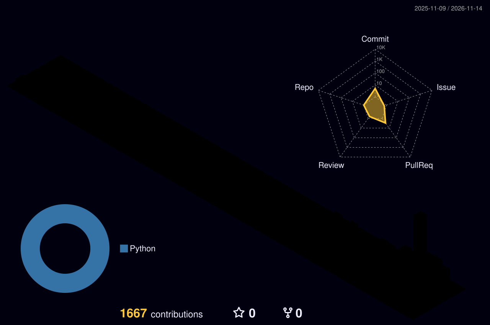
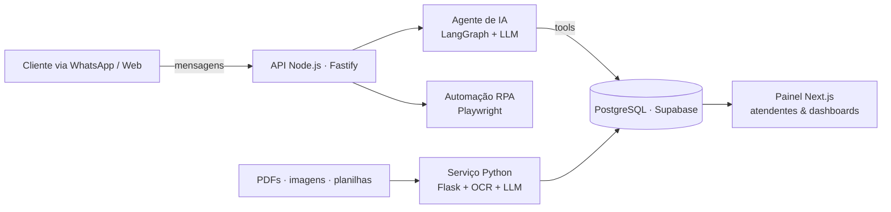

<p align="center">
  
</p>

<p align="center">
  <a href="https://www.linkedin.com/in/pedro-lopes-monteiro/">LinkedIn</a> ·
  <a href="mailto:plmonteiro.com@gmail.com">plmonteiro.com@gmail.com</a> ·
  Vila Velha, ES 🇧🇷
</p>

<p align="center">
  
</p>

```ts
const pedro = {
  role:      "Full Stack Developer @ Iguana Tecnologia",
  education: "Ciência da Computação — UVV",
  location:  "Vila Velha, ES — Brasil",
  builds:    ["plataformas de atendimento com IA", "automação de documentos", "hubs internos & dashboards"],
  stack: {
    front:  ["TypeScript", "Next.js", "React", "Tailwind", "Radix UI", "React Native/Expo"],
    back:   ["Node.js", "Fastify", "Python", "Flask", "PHP/Laravel", "C#"],
    data:   ["PostgreSQL", "Supabase", "MySQL"],
    ai:     ["LangChain", "LangGraph", "OpenAI API", "OCR (RapidOCR/OpenCV)"],
    tools:  ["Playwright (RPA)", "Vitest", "Zod", "pnpm monorepos", "Coolify", "Vercel"],
  },
  openTo: "conversar sobre produto, IA aplicada e arquitetura web",
};
```

## 🧩 O que eu construo

> Meu trabalho principal fica em repositórios privados de clientes. Abaixo, *o que* eu faço, sem código nem dados confidenciais.



<details>
<summary><b>💬 Plataforma de atendimento com IA</b> — Next.js · Fastify · LangGraph · Supabase</summary>
<br/>

- Back-end em **TypeScript + Fastify** integrado a canais de mensagem (WhatsApp via Twilio).
- Agentes de IA com **LangChain/LangGraph** para triagem e classificação de atendimentos.
- Painel do atendente em **Next.js + Tailwind + Radix UI**, com gráficos e exportação para planilha.
- Rotinas de **RPA com Playwright** para tarefas repetitivas em portais.
- Testes com **Vitest**, validação com **Zod** e migrações versionadas em **PostgreSQL**.
</details>

<details>
<summary><b>📄 Automação de documentos</b> — Python · Flask · OCR · LLM</summary>
<br/>

- Serviço em **Flask** que extrai dados de PDFs e imagens (**pdfplumber, RapidOCR, OpenCV**).
- Estruturação dos dados com **LLM (OpenAI API)** e geração de planilhas (**openpyxl**).
- Deploy containerizado (**gunicorn + Coolify**), com versões fixadas pra builds reproduzíveis.
</details>

<details>
<summary><b>🏗️ Hubs internos & dashboards</b> — monorepo pnpm · TypeScript</summary>
<br/>

- Hubs internos em **monorepo pnpm** que reúnem ferramentas da operação num lugar só.
- Dashboards de BI, sites institucionais, landing pages e extensões de navegador.
</details>

## 🎓 Projetos abertos

| Projeto | Stack | Sobre |
|---|---|---|
| [Inova Week App](https://github.com/Pedro-Lopes-Monteiro/Trabalho_B2) | React Native · Expo · Supabase | App do evento Inova Week 2025, com login, grupos e avaliações |
| [Campus BET](https://github.com/Campus-BET-cc5m/campus_bet) | Python | Projeto em equipe na UVV |
| [Gestão de Estoque](https://github.com/Pedro-Lopes-Monteiro/ProjetoPOO2) | C# · WinForms · MySQL | CRUD de estoque com POO e persistência |

## 📈 Atividade

<p align="center">
  
  
</p>

<details>
<summary>🇺🇸 <b>English version</b></summary>
<br/>

I'm **Pedro**, a full stack developer at **Iguana Tecnologia** and a Computer Science student at **UVV** (Vila Velha, Brazil).
I build **AI-powered customer support platforms** (Next.js, Fastify, LangGraph, Supabase), **document automation services** (Python, Flask, OCR, LLMs) and **internal hubs and dashboards** in TypeScript monorepos.
Most of my day-to-day work lives in private client repositories; the diagram and sections above describe it without confidential details.

📫 [LinkedIn](https://www.linkedin.com/in/pedro-lopes-monteiro/) · [plmonteiro.com@gmail.com](mailto:plmonteiro.com@gmail.com)
</details>
